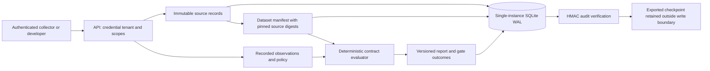

# Architecture and engineering decisions

## Requirements and assumptions

The first system should make evidence lineage, policy checks, data separation, and integrity verification observable. It should run on a developer machine without paid model calls and be deployable as a small single-instance pilot.

Assumptions for v0.2: one process, one region, trusted operators, up to 100 cases per evaluation, 50,000 characters per source, and a 512 KiB HTTP body limit. The test suite checks behavior within these constraints. These are configured bounds, not measured capacity claims. Native SQLite backup/verification and a restore test are implemented; cloud retention and operational recovery remain operator-managed.

## Component and data flow

1. An authenticated ingestion request stores normalized evidence under an immutable versioned ID.
2. A dataset pins the canonical digests of permitted source records, case prompts, expected behaviors, and per-case source allowlists.
3. A run supplies a complete set of recorded observations and a policy. Extra, duplicate, and missing case IDs are rejected before a report is saved.
4. The evaluator checks declared behavior, citation permissions, exact quote presence, and supplied latency/cost against policy.
5. The report and its audit event commit in one transaction. A failed transaction rolls back both.
6. The operator exports a checkpoint and retains it outside the database's mutable boundary.

## Storage model

Every primary key starts with `tenant`. Sources contain normalized text plus a canonical record hash in audit events. Dataset IDs hash their complete manifest, including source record digests. Reports include observation input and policy hashes, engine version, cases, metrics, and explicit limitations.

Audit sequence numbers are scoped to a tenant. Each HMAC covers tenant, sequence, timestamp, event payload, and the preceding hash. Verification also binds events to source, dataset, and report records. There is no delete or update API.

Source and dataset creation are idempotent for identical inputs. Run creation intentionally produces a new run ID each time. Exactly-once execution and retry deduplication for run submissions are not implemented.

## Reliability and concurrency

SQLite WAL allows readers while a writer operates. `BEGIN IMMEDIATE` serializes source, dataset, report, and audit updates. Each operation opens its own connection with a ten-second busy timeout. A storage operational failure returns HTTP 503. A caller should retry only with an understood idempotency strategy; a report may already have committed if a response is lost.

The synchronous API handlers execute in FastAPI's thread pool. The container limits accepted concurrency to 32, but that limit is not a throughput claim. The API buffers at most 512 KiB per accepted request, including chunked bodies. Upstream gateways still need timeouts and rate limits.

## Decisions and tradeoffs

| Decision | Benefit | Cost / point to revisit |
|---|---|---|
| Operator-side provider collection | Explicit bounded egress, measured client latency, provider usage, offline mock tests | Needs a real key/model to verify current account behavior; no provider-signed attestation |
| Deterministic contract grader | Simple to inspect and reproduce | Cannot establish semantic truth or comprehensive safety |
| One service and SQLite | Small operational surface and transactional evidence/audit writes | One writer; no horizontal replication or regional failover |
| Scoped bearer credentials | Concrete access boundary without identity-provider setup | Manual issuance/revocation and no end-user identity |
| HMAC audit chain | Detects unauthorized record/event edits without storing raw secrets in reports | Requires protected key and external checkpoints; no WORM guarantee |
| Explicit supplied policy | Experiments can compare budget and control thresholds | CI must separately enforce approved policy and dataset hashes |
| Fixed provider destinations; no fetched source URLs or executable tools | Restricts egress and removes arbitrary agent execution from this version | Approved evidence leaves the host only on explicit collection; tool execution needs a new boundary |

## Growth path

First collect actual workload, latency, failure, and storage measurements. Migrate to PostgreSQL and object storage when contention, report size, or concurrent workers justify it. Add a durable queue with idempotent jobs and bounded retry semantics before running long model experiments. Add OIDC/machine identity and managed keys before opening the service to an organization.

OpenAI, Anthropic, and xAI collection now use explicit contracts and failure tests. A dry-run plan makes no provider call; execution verifies pinned evidence and sends only each case's permitted records. A private attempt ledger is written before egress and after results; incomplete collections cannot save a successful evaluation run. The public API cannot trigger paid inference.

Semantic graders, server-attested telemetry, GPU scheduling, and simulation adapters remain separate work. There is no need to operate a GPU cluster for this release.
